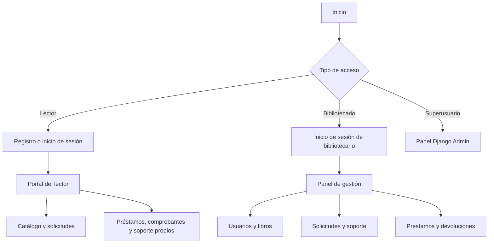

# Flujo general del sistema

El detalle del ciclo de préstamo y devolución está en `diagramas/Diagrama_Flujo_Prestamo.drawio`.

> Revisión de paquete: 14/10/2026. Ver también `docs/diagramas_y_modelos_2026-10-14.md` y `docs/limite_email_50_2026-10-14.md` para los diagramas editables y el límite actualizado de correo.
